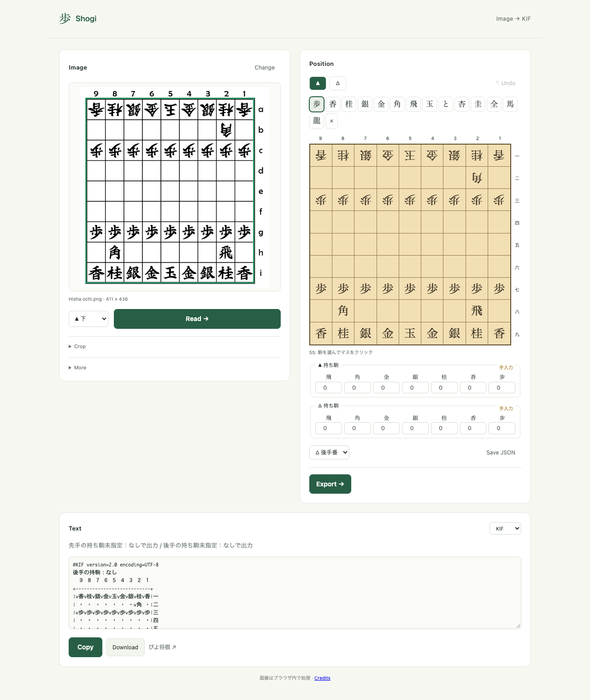

# shogi-image-to-kif

将棋の盤面画像を読み取り、**確認・修正して、ぴよ将棋に取り込める局面テキストを作る**アプリです。GitHub Pages版とローカル版があります。画像ファイルの選択、ドロップ、クリップボードの画像貼り付けに対応します。外部API・APIキーは不要です。

**Web:** https://theoremoon.github.io/shogi-image-to-kif/

Web版は画像を端末のブラウザ内で処理します。インストール不要。初回のRead／Exportでは実行環境をダウンロードするため少し待ちます。手番・持ち駒は入力できますが、Web版の自動OCRは未対応です。ウォーズ用字形モデルは同梱しています。


## 起動

Python 3.12以上と[uv](https://docs.astral.sh/uv/)が必要です。

```sh
cd shogi-image-to-kif
uv sync
uv run shogi-image-to-kif serve
```

ブラウザで **http://127.0.0.1:8765** を開きます。終了はターミナルでCtrl+C。別のポートを使う場合は `serve --port 8766`。

1. 画像を選び、先手が下か後手が下かを指定して「Read →」を押す。
2. 原画像と盤面を比較。駒を選んでマスをクリックすると修正できる。黄色は特に確認が必要なマス、`？`は未判別。駒は「×」で除去でき、修正を戻すことも可能。
3. 双方の持ち駒と手番を確認。画像に写っていない持ち駒も、なしと決めつけず手入力する。
4. 「Export →」を押し、「Copy」でコピー、または「Download」で保存。ぴよ将棋の棋譜読み込みに貼り付けるか、KIFファイルを開く。

読み取り後はすぐに出力できます。未指定の手番は先手、持ち駒はなし、未判別の「？」は空マスとして出力し、補完した内容を表示します。駒数の異常も出力を止めず表示します。CLIの `--reviewed` による確認済み出力は従来通り厳密に検証します。

盤面の自動検出が失敗した場合は「Crop」を開いて「Select」で外枠の左上と右下をクリックします。対応する字体でなくても、空の盤から入力して出力できます。途中の修正は「Save JSON」で保存し、「More」から開けます。「More」にはサンプル画像とSFENの入力もあります。



## 認識できるもの

- 罫線のある2Dの9×9盤面。盤面検出と、駒種・成り・所属のテンプレート認識。
- 180度反転した画像、JPEG圧縮、多少のリサイズ、黄色の直前手ハイライト。
- 日本語の持ち駒・手番の補助OCRと、金・成駒の曖昧な字形の補助判定。**TesseractがPATH上にある場合のみ**自動で使用する。日本語モデルは同梱している。Tesseractがなくても盤上の認識と修正・出力は利用可能。

字体が大きく違う画像、低解像度、駒を覆う矢印、切り抜かれた盤面、実物の斜め写真などは誤認識や検出失敗が起こります。認識の一致スコアは確率ではなく、黄色でないマスにも誤認識があり得ます。**最後の原画像との照合は必須です。** 履歴・指し手は生成しません。画像に手数がないため、初期手数は1として出力します。

## 出力と互換性

- **KIF**：任意開始局面、成駒、双方の持ち駒、先手番/後手番を含む。デフォルト出力。
- **BOD**：局面図テキスト。局面編集用。読み込み方法はアプリによって異なる。
- **SFEN**：ぴよ将棋WEB版で認識される `sfen ` 接頭辞付き。内部の局面モデルでは接頭辞なしの標準SFENを扱う。

ぴよ将棋[WEB版](https://www.studiok-i.net/ps/)の実際のKIF読み込み処理で、平手・飛車落ち後手番・全成駒と双方の持ち駒・片玉の詰将棋の**4ケースすべて、81マス・持ち駒・手番が一致**しました。[検証記録](docs/piyo-browser-compatibility.json)を保存しています。スマホ版の実機試験は含みません。

## CLI

```sh
# 認識結果は確認用JSON。未確定情報はnull、未判別駒は "?"。
uv run shogi-image-to-kif recognize board.png -o draft.json
# 反転画像。盤の座標を手動指定することも可能。
uv run shogi-image-to-kif recognize board.png --orientation gote_bottom --bounds 20 30 560 570 -o draft.json
# 認識後のJSONを修正し、画像と照合してから出力する。
uv run shogi-image-to-kif export --draft draft.json --reviewed -o position.kif
# 持ち駒・手番を別途確認済みなら認識時に明示できる。
uv run shogi-image-to-kif recognize 'data/samples/raw/Hisha ochi.png' --turn w --hands - -o draft.json
uv run shogi-image-to-kif export --draft draft.json --reviewed -o position.kif
# 手入力の確定SFENから出力。
uv run shogi-image-to-kif export --sfen '4k4/9/9/9/9/9/9/9/9 b R2P 1' --format kif
# 古い読み込み環境向けにShift_JIS系のKIFも保存できる。
uv run shogi-image-to-kif export --draft draft.json --reviewed --encoding cp932 -o position.kif
```

`--hands`は先後を含むSFENの持ち駒部分（先手大文字/後手小文字）。例: `S2P3p`、双方なしは `-`。`draft.json` の `board` は段1→9、各段は筋9→1の81要素。空マスはnull、先手は `P` / `+P`、後手は `p` / `+p` など。不明なマス・持ち駒・手番がある状態では出力できません。JSON中の `reviewed` だけではCLIの `--reviewed` の代わりになりません。

## データと検証

公開サンプル12枚、原画像と作者・ライセンス・SHA-256付き。盤面6枚に手動ラベルを付け、2枚をテンプレート参照、残り4枚を動作評価に使用しました。**4枚324マスすべて一致**。ただし同系列の字体を含む小規模評価で、SNS全般の認識精度を表す数字ではありません。持ち駒の自動OCRは別途確認が必要です。追加で保存したぴよ将棋WEB版の平手画像では、補助OCR込みで81/81マス一致しました（ローカル検証用の1枚、独立評価セットには含めない）。

```sh
uv run shogi-image-to-kif samples
python3 scripts/download_samples.py
uv sync --extra dev
uv run pytest -q
uv run ruff check src scripts tests
uv run python scripts/evaluate.py
# UI検証：別ターミナルでserveを起動してから
uv run playwright install chromium
uv run python scripts/smoke_ui.py
# 実際のぴよ将棋WEB版との互換性確認（ネットワーク接続が必要）
uv run python scripts/verify_piyo_browser.py
```

設計は [docs/architecture.md](docs/architecture.md)、データと評価の詳細は [docs/dataset.md](docs/dataset.md)、同梱素材の出典は [docs/third-party.md](docs/third-party.md) を参照。アップロード画像はメモリで処理し、サーバーには保存しません。スクリーンショット収集コマンドの保存先 `data/local-samples/` はGit対象外です。

将棋ウォーズ向けの字形モデルは同梱済みです。ローカルで再構築する場合は `uv run python scripts/setup_wars.py` で取得・作成できます。木目盤の自動検出と五角形の駒に対応し、別の公式画面1枚で79/81マス一致（龍・馬は要修正）。このプロジェクト直下でサーバーを起動して画像を開くと自動利用します。手番・持ち駒は手入力で確認します。詳細と評価の範囲は [データセット](docs/dataset.md#将棋ウォーズの画面サンプル) に記録しています。

## GitHub Pages

静的ビルドは `python scripts/build_site.py`。出力先は `dist/site/`。Pyodide 0.28.1 + NumPy/OpenCV/PillowをWeb Workerで起動し、ローカル版と同じPython認識・出力処理を使います。初回はjsDelivrからランタイムをダウンロードし、画像データは送信しません。

リポジトリの Settings → Pages → Source を **GitHub Actions** にすると、mainへのpushで `.github/workflows/pages.yml` がテスト・ビルド・公開を実行します。

```sh
python scripts/build_site.py
python -m http.server 8770 --directory dist
# 別ターミナル。公開時と同様にサブパスで検証する
uv run python scripts/smoke_ui.py --url http://127.0.0.1:8770/site/ --timeout 180000
uv run python scripts/smoke_pages.py --url http://127.0.0.1:8770/site/
```

Web版ではTesseractを使わないため、ぴよ将棋の字体で金と成駒の候補が異なる場合があります。認識結果は編集できます。公開物にはウォーズ等の私的検証キャプチャ、OCRモデル、アップロード画像を含めません。字形参照の出典はassetsのJSONと公開画面のCreditsに記載しています。
