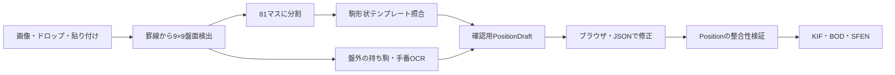

# アーキテクチャ

## 実装済みの流れ

Python 3.12+ / uv。NumPy・OpenCV・Pillowを実行依存に採用。HTTPは標準ライブラリのループバック限定サーバー、画面はHTML/CSS/JavaScript。アップロードはJSON内の画像データとして受け取り、ファイル名からサーバー上の任意ファイルを開かない。画像は16MB・2400万画素以下。外部API、クラウド、APIキーは不要。

## 各層

| モジュール | 責務 |
| --- | --- |
| `domain/position.py` | 確定局面とSFENの入出力、駒数上限・玉重複・不正値の検証、二歩などの警告 |
| `recognition/grid.py` | EXIF向き補正、透過を白背景へ合成、水平/垂直線の形態学的検出、10本ずつ等間隔の検証、マスの切り出し、座標文字で隠れた外枠の補完 |
| `recognition/templates.py` | 黒/赤文字の抽出、形状の正規化、312枚のテンプレートとの比較、候補とスコア |
| `recognition/metadata.py` | 任意のTesseract日本語OCR。盤外の領域、横書き/縦書き、明示された持ち駒・手番を候補として読む。金と成駒の僅差候補を補助判定 |
| `recognition/pipeline.py` | 各認識結果の組み立て、反転の正規化 |
| `exporters/kif.py` | 局面図KIF/BODへの変換。先後、成駒、漢数字の枚数、手番 |
| `cli.py` | `recognize` / `export` / `samples` / `serve` |
| `server.py`, `web/` | 原画像と候補盤面の比較、駒の修正/undo、持ち駒・手番入力、確認、コピー/保存 |

## 局面と不明値

盤面は81要素。段1→9、各段は筋9→1。先手駒は大文字、後手駒は小文字、成駒は `+` 接頭辞。空マスはnull、未判別は `?`。持ち駒は先後別の辞書（飛角金銀桂香歩）で、領域がない/読めない場合はnull。手番はb/w/null。

`PositionDraft`はJSONとして保存でき、各マスの候補・一致スコア・要確認インデックス・盤領域・補助OCRテキストを含む。スコアは未較正の一致度であり確率ではない。未確認の持ち駒入力は `pending_hands` として途中保存する。

確認後の `Position` では不明値を認めず、駒種、成り、枚数上限、同側の玉重複を検証する。詰将棋・駒落ちに対応するため総数40未満や片玉は許容し、二歩/行き所のない駒は警告として出す。矛盾を認識器が勝手に修正することはしない。手数が画像にない場合は1。KIF/BODで手数履歴は作らない。

画像の上下と手番は別の属性。先手が上の画像は、結果を180度並べ替え、駒の所属を反転して先手が下の内部表現へ戻す。手番表示のない画像は手入力する。画面で駒・手番・持ち駒を変えたら既存の出力と確認フラグを無効にする。

## 認識方式と限界

罫線の等間隔性と交差範囲から盤を検出し、見つからなければユーザーが外枠を指定する。斜め写真への射影補正は未対応。最大面積の盤を選ぶので、複数盤面の画像は対象を手動指定する。

駒の色付き外枠と木目が文字として残らないよう、暗い文字部分を抽出する。金/全など僅差の候補だけはTesseractの一文字OCRを併用し、テンプレート上も近い候補だった場合だけ補正する。OCRによる補正マスも要確認のままにする。

テンプレートは出典のある2枚の局面画像の駒を正規化したものと、複数の日本語フォントで描画した一文字/二文字の駒から作る。上下逆の字形も照合する。ランタイムにフォントは不要。比較はずらしを許したsoft Dice一致度と次候補との差。字体・背景・駒の外枠などが異なると誤認識するため、最終確認を前提とする。黄色の直前手マークを文字として扱わないよう輝度を使う。

持ち駒は言語モデルではなくTesseractの補助OCR。未認識、複数候補の矛盾、見切れは手入力で補う。「▲先手」という所属表記だけでは手番を推測しない。「先手」だけで持ち駒ゼロと判断もしない。

## 出力の検証

KIFは任意開始局面の9行の図、双方の持ち駒、先手番/後手番、指し手ヘッダーからなる。WEB版の `readKif` を実ブラウザで実行し、全マス/持ち駒/手番の往復一致を4ケース確認した。公開 `BOD2SFEN` でも検証記録を残している。スマホ実機は未確認。

SFEN出力はWEB版で形式判定される `sfen ` 接頭辞付き。UTF-8が標準で、CLIのKIF/BODファイル保存にはCP932も選べる。

## 今後の拡張点

異なるアプリの字体を十分に含む独立評価セット、テンプレート追加/学習分類器、盤のないテーマや実物写真への対応。今回の実装は2D盤面を読み取って修正・出力する初版で、任意のSNS画像の完全自動変換を保証するモデルではない。

ブラウザの Export は確認チェックを要求せず、`/api/export` に `preview: true` を送る。未指定の手番は先手、持ち駒は空、未判別マスは空マスとして出力し、補完内容をレスポンスのwarningsに含める。認識された確定駒は駒数が異常でも保持して表示する。形式・駒の種類・手数・持ち駒の入力値は検証する。CLIと確認済みAPI出力は従来の厳密なPosition検証を利用する。

GitHub Pages版は静的HTML/CSS/JSとPythonコード・数値モデルのzipで構成する。`site/backend.js` がローカルAPI呼び出しをWorkerへのメッセージに置き換え、`site/worker.js` がPyodide 0.28.1・NumPy・OpenCV・Pillowを起動する。`browser.dispatch` と共通の `exporters.draft.export_draft` を使い、同じ局面認識と出力を行う。Worker内のリクエストは直列化する。画像の送信先サーバーはなく、サンプル・ランタイムのGETだけを行う。相対URLを使用し、リポジトリ名のサブパスに対応する。ブラウザ版のOCRは無効化する。
